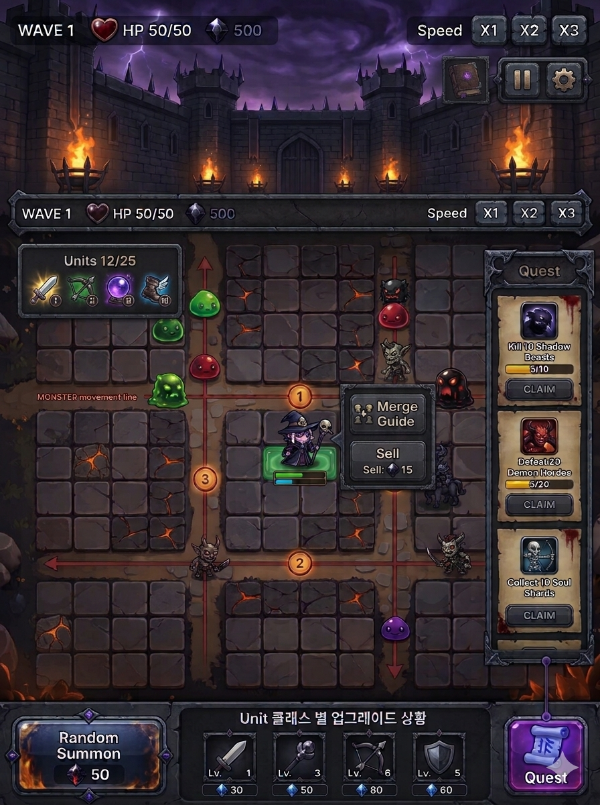

# 다크 판타지 랜덤 디펜스 게임 UI/UX 기획 보고서

## 1. 개요
* **장르:** 타워 디펜스 / 랜덤 유닛 소환 전략 게임
* **테마:** 다크 판타지 (어두운 석조 성벽, 용암 균열 타일, 마법 및 언데드 콘셉트)
* **화면 구성:** 상단 상태 및 유틸리티 영역, 중앙 전투 그리드 보드, 하단 소환 및 강화 컨트롤 영역으로 구성된 세로형 모바일 UI

---

## 2. 영역별 상세 UI 구성

### 2.1. 상단 배경 및 유틸리티 영역 (Top Bar & Header)
* **전투 상태 표시 (좌측 상단):**
  * **WAVE:** 현재 진행 중인 웨이브 단계 (`WAVE 1`)
  * **HP:** 플레이어의 남은 생명력 (`HP 50/50`) 및 하트 아이콘
  * **보유 재화:** 유닛 소환 및 업그레이드에 사용되는 마나/보석 재화 수량 (`500`)
* **시스템 컨트롤 (우측 상단):**
  * **게임 배속 (Speed):** `X1`, `X2`, `X3` 토글 버튼을 통한 전투 속도 조절
  * **유틸리티 아이콘:** 배속 버튼 하단에 배치되어 전투 보드를 가리지 않음
    * **도감(책 아이콘):** 유닛 조합식 및 몬스터 정보 확인
    * **일시정지(`||`):** 게임 일시정지
    * **설정(톱니바퀴):** 사운드, 그래픽, 데미지 표기 등 환경설정

### 2.2. 중앙 전투 보드 영역 (Main Battle Grid)
* **몬스터 이동 경로 (Monster Movement Line):**
  * 그리드 타일 사이를 가로지르는 붉은색 화살표 라인으로 적의 이동 동선과 순환 방향(1~4번 마커)을 직관적으로 안내
* **보드 유닛 및 시너지 현황 (좌측 상단 오버레이):**
  * **유닛 배치 수:** 현재 필드에 소환된 유닛 수와 최대 수용 한도 표시 (`Units 12/25`)
  * **시너지 버프:** 활성화된 클래스별(전사, 궁수, 마법사, 암살자/기동 등) 시너지 단계 및 아이콘 표시
* **유닛 상호작용 팝업 (중앙):**
  * 필드의 특정 유닛 선택 시 우측에 컨텍스트 메뉴 출력
  * **Merge Guide:** 상위 등급 유닛으로 합성하기 위한 조합 가이드 및 즉시 합성 기능
  * **Sell:** 해당 유닛을 판매하고 일정량의 재화(`Sell: 15`)를 회수하는 버튼
* **퀘스트 슬라이드 패널 (우측 사이드바):**
  * 우측 하단 `Quest` 버튼 클릭 시 펼쳐지는 반투명 사이드 창
  * 진행 중인 미션 목록(예: *Kill 10 Shadow Beasts*, *Defeat 20 Demon Hordes*)과 진행도 게이지(`5/10`), 보상 수령(`CLAIM`) 버튼 제공

### 2.3. 하단 액션 및 강화 영역 (Bottom Control Panel)
* **Random Summon (좌측):**
  * 일정 재화(`50`)를 소모하여 보드의 빈 타일에 무작위 유닛을 소환하는 메인 액션 버튼
* **Unit 클래스 별 업그레이드 상황 (중앙):**
  * 4가지 주요 클래스(검, 지팡이, 활, 방패)의 현재 강화 레벨(`Lv. 1`, `Lv. 3`, `Lv. 6`, `Lv. 5`) 표시
  * 각 버튼 하단에 다음 레벨 업그레이드에 필요한 재화 비용(`30`, `50`, `80`, `60`)을 명시하여 직관적인 자원 관리 유도
* **Quest 토글 버튼 (우측):**
  * 우측 퀘스트 패널을 열거나 닫는 전용 스위치 버튼

---

## 3. UX 설계 핵심 포인트
1. **시야 확보 최적화:** 도감, 일시정지, 설정 버튼을 상단 성벽 배경 영역으로 배치하여 중앙 전투 타일의 가시성을 극대화함.
2. **직관적인 자원 피드백:** 소환 버튼과 클래스별 업그레이드 버튼 내부에 소모 재화를 직접 표기하여 플레이어가 별도 창을 열지 않고도 즉시 강화 여부를 판단할 수 있도록 설계함.
3. **모듈형 퀘스트 창:** 필요할 때만 열어볼 수 있는 우측 슬라이드 방식을 채택해 화면 복잡도를 낮춤.

## 4. 참고 이미지
1. 